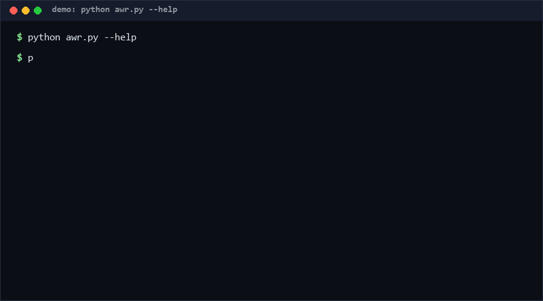

# ascii-widget-registry

A JSON registry spec + distributor for ASCII/text animation assets. Widgets (loaders, scenes, charts, logos, banners) ship as data — frames, fps, tags — validated against a schema and served by id, kind, or tag. If your site or agent needs one-line ASCII motion without a framework, use this; if you need canvas-grade generative art, you need a real renderer instead.

**As of 2026-10-11.**

<p align="center"></p>

## Problem

ASCII animation assets today are trapped in three bad containers: hard-coded in source files, pasted into docs as one-off snippets, or bundled inside framework components (React/Next) that a static generator or an agent CLI cannot use. There is no way to say "give me the `spinner` loader" across tools — no schema, no validation, no lookup.

A registry fixes this the way package manifests fixed script soup: widgets become validated data files. Agents can generate or consume them directly; static sites can inline a frame at build time; a terminal tool can play them without importing anything.

## How it works

A registry is one JSON file, schema `awr/1`:

```json
{
  "schema": "awr/1",
  "widgets": [
    {"id": "spinner-classic", "kind": "loader", "fps": 8,
     "tags": ["spinner"], "frames": ["|", "/", "-", "\\"]}
  ]
}
```

The validator enforces: unique `[a-z0-9-]` ids, `kind` in `{loader, scene, chart, logo, banner}`, non-empty string frames (≤200 lines each, ≤1000 frames per widget), integer fps 1–60. Frame strings containing control characters get a warning (they survive validation but may misrender on ASCII-only terminals). Distribution primitives: `get(id)` (KeyError on miss), `search(kind, tag)`, `render_frame(widget, i)` with modulo wrap so a caller can request frame 4000 of a 4-frame loop safely.

## Quickstart

```bash
# ~5 s: validate the example registry
python awr.py validate registry.example.json

# ~5 s: browse the shelf
python awr.py list registry.example.json --kind loader

# ~5 s: play one widget in your terminal
python awr.py get registry.example.json spinner-classic

# ~5 s: self-test (17 cases)
python self_test.py
```

## Why not X

| Alternative | Why not alone |
|---|---|
| React/Next registry components | Requires a JS framework and a build step; agents and CLIs cannot consume it |
| Copy-pasted snippet collections (gists, awesome lists) | No schema, no validation; frames rot silently; no lookup by kind/tag |
| Lottie / GIF / APNG assets | Binary, opaque to agents, not greppable, not diffable; ASCII stays text-first |
| Unicode escape-sequence engines (curses etc.) | Terminal-control power at the cost of portability; frames here are plain printable text |

## Minimal Fallback

No Python? The registry is plain JSON: any `jq` one-liner replaces `list` (`jq -r '.widgets[].id'`), and `get --frame N` is `jq -r '.widgets[] | select(.id=="X") | .frames[0]'`. Validation beyond shape-checking is lost, but frames remain usable text in any language.

## Design Trade-offs

Priority order when goals conflict: **plain-text portability > schema strictness > visual richness**.

- Frame arrays over generator functions: bigger JSON, but zero code execution, trivially diffable, agent-writable.
- Fixed 5-kind taxonomy: loses free-form tagging granularity, gains predictable filters.
- Pre-rendered frames over animation math: larger files for smooth effects; accepted because math lives in code, data stays data.
- Block/box-drawing chars allowed but warned: pragmatic middle ground between strict ASCII and full Unicode.
- No network distribution built in: a registry is a file; hosting it (git, CDN) is your choice.

## Limits & Second-order Effects

- **Limits.** Modulo-wrapped playback only — no easing, no interactivity, no color escape sequences; 200-line/1000-frame caps bound pathological files; the "registry" has no signing or authenticity layer, so a tampered registry file validates as happily as an honest one.
- **Second-order effects.** As registries multiply, widget-id collisions across projects become likely (`spinner-classic` is nobody's trademark) — consumers should namespace by registry file, not assume global ids. ASCII animation also re-popularizes text-heavy pages that accessibility tools handle unevenly; keep static-text equivalents. And because frames are data, scrapers will repack registries without attribution — the spec records nothing about provenance by design; add it locally if you care.

## FAQ

**Q: Can a widget execute code?** No. Frames are strings; the renderer only indexes and prints. Validation rejects non-string frames outright.

**Q: How do I play an animation on a webpage?** Inline frames and cycle them on an interval, or render one static frame (`--frame N`) as decoration — both are build-time operations, no runtime dependency.

**Q: Why validate fps?** Playback consumers need a default cadence; unvalidated fps is how "8" becomes `"8 fps"` becomes a crash.

**Q: Does it ship with widgets?** One example registry (6 widgets) for tests and demos; the format is the product, not the catalog.

**Q: When NOT to use this?** (Socratic check) Not for rich generative visuals (use canvas/WebGL), not for accessibility-critical UI (animation as data has no reduced-motion negotiation here), not as an authenticity mechanism (nothing is signed), and not if your frames need color/escape codes — the validator will warn you off.

## Core Assumptions

- [A1] ASCII motion remains useful precisely because it is plain text — greppable, diffable, agent-writable. *(High confidence.)*
- [A2] A 5-kind taxonomy covers the practical use of text animations in docs/sites/CLIs. *(Medium confidence — taxonomy derived from one registry family's catalog [estimated], not a market survey.)*
- [A3] Schema-validated data files beat framework components for cross-tool distribution. *(High confidence.)*
- [A4] Frame caps (200 lines × 1000 frames) are generous enough for real assets. *(Medium confidence — fits the example family; exotic scene loops may hit it.)*

*Measured marker: self-test 17/17 PASS (repro `python self_test.py`), including an 800-widget registry validation and CLI roundtrips. Knowledge cutoff: 2026-10-11.*
